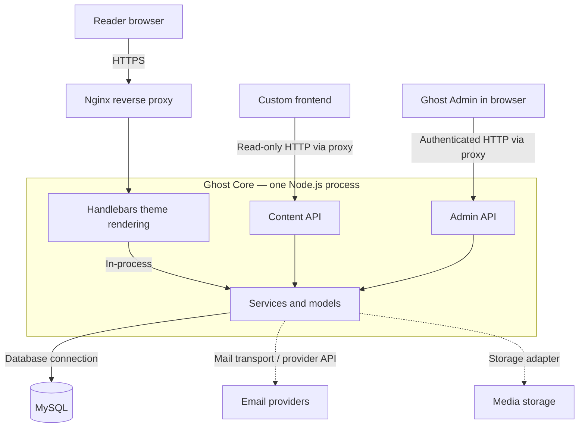

# Ghost Architecture Lab

An AD371 companion application for **Architectural Analysis, AI-Assisted Prototyping, and Quality Assurance**.

The project studies [Ghost](https://github.com/TryGhost/Ghost), an open-source publishing platform, and turns the analysis into an interactive architecture explorer and publishing proof of concept. It was created with OpenAI Codex on October 21, 2026.

**Live website:** [Ghost Architecture Lab](https://ching202.github.io/ghost-architecture-lab/)

**Public repository:** [ching202/ghost-architecture-lab](https://github.com/ching202/ghost-architecture-lab). Deployment details and verification are recorded in [DEPLOYMENT.md](docs/DEPLOYMENT.md).

## What you can do

- Inspect seven architectural components and their responsibilities, boundaries, and trade-offs.
- Switch between a reader request and an editorial publishing request.
- Create, publish, and unpublish browser-local stories; only published stories enter the reading view.
- Inject a simulated database outage and verify that failed writes leave state intact.
- Test whitespace, length limits, duplicate slugs, literal HTML-like text, and blocked/corrupted storage.
- Record manual QA observations and export a JSON notebook.

**Scope:** this is an architectural visualizer plus a browser-local simulation, not a deployed Ghost installation. It does not implement authentication, issue Ghost API requests, connect to MySQL, or send email. The simulated public/private views share the same browser and do not provide real access control. A real database outage may affect reads as well; the demo retains its existing in-memory reading view for teaching purposes.

## Run locally

For an immediate offline demonstration, open **[preview.html](preview.html)** in Chrome or another modern browser. It bundles the same app into one file; use `node build-preview.mjs` to regenerate it after edits. The deployable source remains `dist/`.

Requires Node.js 22 or newer. The delivered project was tested with Node.js 24.19.0. This is the prototype's requirement, not a Ghost installation recommendation.

Clone the public repository:

```sh
git clone https://github.com/ching202/ghost-architecture-lab.git
cd ghost-architecture-lab
node server.mjs
```

Open the printed local address, normally `http://127.0.0.1:4173`. Stop with Ctrl+C. No package installation, build step, environment secrets, or Ghost account is needed. Serve over HTTP; do not double-click `index.html` because it uses JavaScript modules.

Optional port change in PowerShell:

```powershell
$env:PORT = '4185'
node server.mjs
```

The source and deployable files are the same files in `dist/`. The Node server is only a local development convenience; static hosts serve `dist/` directly.

## Architecture analysis

Ghost describes its product as a decoupled, service-based application. This study uses **modular monolith with decoupled clients** as an analytical description of its principal runtime. The distinction is about deployment and process boundaries, rather than the number of boxes in a diagram. See the official [architecture overview](https://docs.ghost.org/architecture/) and [runtime guide](https://github.com/TryGhost/Ghost/blob/main/docs/codebase/runtime-architecture.md).



The diagram simplifies routing, middleware, cache hits, and optional features. The theme's internal access is not an HTTP Content API call. The API and theme interfaces share Core's runtime. [Runtime evidence](https://github.com/TryGhost/Ghost/blob/main/docs/codebase/runtime-architecture.md).

| Boundary | Responsibility and evidence |
| --- | --- |
| Browser ↔ server | Ghost Admin uses the [Admin API](https://docs.ghost.org/admin-api/). Custom readers can use the read-only [Content API](https://docs.ghost.org/content-api/). |
| Rendering | [Handlebars themes](https://docs.ghost.org/themes/) produce publication HTML. A headless frontend is another rendering choice. |
| Persistence | MySQL is in the supported [production stack](https://docs.ghost.org/hosting/). [Models and schema](https://github.com/TryGhost/Ghost/blob/main/docs/codebase/database.md) describe persistent publication records. |
| Proxy and lifecycle | Nginx and systemd are recommended infrastructure. Neither is an application module inside Node.js. [Hosting stack](https://docs.ghost.org/hosting/). |
| Caches | Internal caches and HTTP response caches are distinct; Redis is not a universal requirement. [Configuration](https://docs.ghost.org/config/). |
| Mail | Transactional mail configuration does not by itself configure native bulk newsletters. [Newsletter delivery](https://docs.ghost.org/newsletters/). |

There is no mandatory standalone message broker in this model. Ghost's events/background work do not establish a Kafka or RabbitMQ dependency. Ghost 6's separately operated ActivityPub and analytics services are intentionally outside the focused publishing map. [Optional service scope](https://docs.ghost.org/hosting/).

The engineering trade-off is our inference: shared process boundaries make calls and deployment simpler, while increasing shared resource/failure coupling. A custom frontend offers rendering flexibility but adds integration, cache-freshness, and deployment decisions.

## Prototype design

`dist/core.js` contains pure validation, slug allocation, and state transitions. `dist/app.js` controls navigation, DOM updates, persistence, and QA export. User story content is inserted with `textContent`, never evaluated as markup. Local storage uses a versioned format and validates restored records; failures fall back to memory with a visible warning. The collection is capped at 40 stories and input fields have bounded sizes.

These choices are specific to this teaching app. They do not represent Ghost's actual database schema, concurrency model, authentication, scheduling, or member-only content behavior. Multiple browser tabs are not synchronized; the last successful local-storage write wins. Reset clears only this app's local stories or notebook.

## AI disclosure and verification

**Tool:** OpenAI Codex desktop coding assistant, with a research subagent using the same assistant service. GitHub Pages hosts the app; an earlier Sites deployment attempt did not complete. Playwright, the in-app browser, and Node's built-in test runner were used for QA. No other LLM provider was used. The exact backend model revision is not exposed in the project artifacts.

The user supplied the assignment and selected the full project option. Codex selected Ghost and generated the application, tests, and documents. This is disclosed AI-assisted work; the student must review the findings, rehearse the demonstration, and describe their own engineering understanding.

The complete user assignment is retained in [ASSIGNMENT.txt](docs/ASSIGNMENT.txt). The [prompt appendix](docs/AI_PROMPTS.md) records the exact user selection, assistant task brief, and research prompt. [initial-core.js.txt](docs/initial-core.js.txt) preserves the first generated domain module. The appendix separates verified assumptions from actual defects: it does not claim that the AI made architectural mistakes that did not occur.

Customizations include explicit process boundaries, separate read/write traces, the source audit table, failure injection, accessible field errors, defensive storage, plain-text rendering, and the QA notebook. QA found and fixed a switch hit-target issue and navigation overflow at 320 px. A test-only route timing assertion was also corrected to await the hash-change render.

Source analysis is dated October 21, 2026. Upstream `main` is mutable and may include unreleased work; no claim about the latest stable Ghost version is made. A release-specific extension should pin a Ghost tag/commit and verify its requirements afresh.

## Testing and evidence

```sh
node --test tests/core.test.mjs
```

The domain suite covers state transitions, validation, failure invariants, slug uniqueness, collection bounds, and storage recovery. Earlier results: **12 domain tests, 15 Chrome fixture check groups, and 6 standalone-preview smoke checks passed**. The live deployment subsequently passed **15/15 check groups in Chromium 151.0.7922.34 and 15/15 in Firefox 153.0** on Ubuntu 24.04, with zero page errors, console errors/warnings, HTTP error responses, or failed requests. [Successful run](https://github.com/ching202/ghost-architecture-lab/actions/runs/39690676950). The earlier Windows Firefox launch failure is preserved as environment history. See [QA_REPORT.md](docs/QA_REPORT.md) for results and limits, [QA_CHECKLIST.md](docs/QA_CHECKLIST.md) for manual recording steps, and `docs/evidence/` for evidence. Do not mark a manual check complete solely because a checkbox exists in the app.

Optional browser suite, in a second terminal while the server runs:

```sh
npm install --no-save playwright@1.62.1
npx playwright install chromium firefox
node tests/browser-check.mjs
```

`BASE_URL` selects another origin. `BROWSER_ENGINES=firefox` selects Firefox alone; the default is both engines. `EVIDENCE_DIR` chooses a fresh results directory relative to the project. `CHROMIUM_PATH` and `FIREFOX_PATH` can select local executables. `PLAYWRIGHT_MODULE` can point to an already-installed package. `FIXTURE_MODE=1` serves the exact static bytes through Playwright request routing for restricted environments; this is a rendering/interaction test, not a hosting test. The suite reports a failure if either requested browser cannot complete. The **Verify live browser behavior** GitHub Actions workflow repeats the full live-site run and saves an evidence artifact. Record your own DevTools walkthrough before submitting the video.

## Publish to a public GitHub repository and Pages

The public repository was created through the authenticated GitHub website under `ching202`. The source includes `dist/`, `docs/`, `tests/`, `README.md`, `package.json`, `server.mjs`, and the `.github/` workflow. Downloaded browsers, dependencies, credentials, and the unrelated Sites hosting manifest are excluded. For another new repository, the equivalent Git commands are:

```sh
git init
git add .
git commit -m "Build Ghost architecture lab with QA evidence"
git branch -M main
git remote add origin YOUR_ACTUAL_REPOSITORY_URL
git push -u origin main
```

If the folder is already a Git repository, inspect `git remote -v`; the Sites source remote is not the required public GitHub repository. Add your GitHub repository as a separate remote named `github` and push `main` there rather than replacing the existing remote.

In the GitHub repository's **Settings → Pages**, choose **GitHub Actions**. Run the included **Publish architecture lab** workflow if needed. It tests the domain functions and publishes only `dist/`. The workflow follows GitHub's [official static Pages example](https://github.com/actions/starter-workflows/blob/main/pages/static.yml). Use the actual URL returned by the successful workflow; do not submit a guessed URL.

The first Pages workflow completed successfully on October 21, 2026. A live-browser smoke check verified component selection, request traces, validation, draft creation, failed-write recovery, publication, reload persistence, unpublication, and reset. No warning/error console entries were captured during that check. See [DEPLOYMENT.md](docs/DEPLOYMENT.md) for the verified URL and remaining QA limits.

