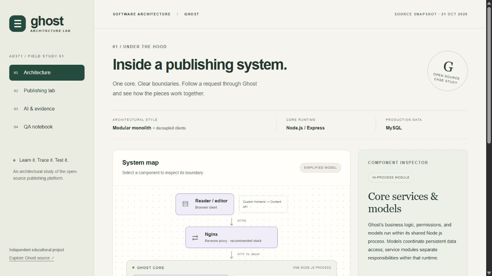

# Deployment record

**Status: deployed and smoke-tested on October 21, 2026.**

- [Live website](https://ching202.github.io/ghost-architecture-lab/)
- [Public GitHub repository](https://github.com/ching202/ghost-architecture-lab)
- [README and architecture analysis](https://github.com/ching202/ghost-architecture-lab#readme)
- [First successful deployment run](https://github.com/ching202/ghost-architecture-lab/actions/runs/39689303104)
- [Current workflow runs](https://github.com/ching202/ghost-architecture-lab/actions)

The repository is public under `ching202`. Settings → Pages uses GitHub Actions. Each push to `main` runs `.github/workflows/pages.yml`, tests domain behavior with Node's built-in test runner, and publishes `dist/` to GitHub Pages. The application is buildless; its five source files are served directly. No third-party package installation or deployment secret is required.

## Live verification

The workflow returned the website URL above. The Codex in-app browser loaded the real HTTPS URL and exercised component selection, the publishing request trace, empty-form validation, draft creation, rejected publication during a simulated database outage, successful retry, reload persistence, unpublication, and reset. The AI evidence and QA notebook routes rendered. The captured warning/error console log was empty. Temporary test stories were reset.

This is a static educational simulation: publishing a story changes only that browser's local data. It does not publish posts to a real Ghost server or to GitHub.

## Remaining student checks

Chromium and Firefox subsequently passed the full 15-group browser suite against this URL in fresh unauthenticated contexts on Ubuntu 24.04. See [QA_REPORT.md](QA_REPORT.md) and the [successful workflow](https://github.com/ching202/ghost-architecture-lab/actions/runs/39690676950). The student should still show Console/Network live in the recording and check the repository/video links for instructor access. The automated Firefox result is from Linux, not a local Windows manual test.

An earlier Sites hosting attempt did not complete. GitHub Pages is the active deployment; no Sites URL is needed for submission.
